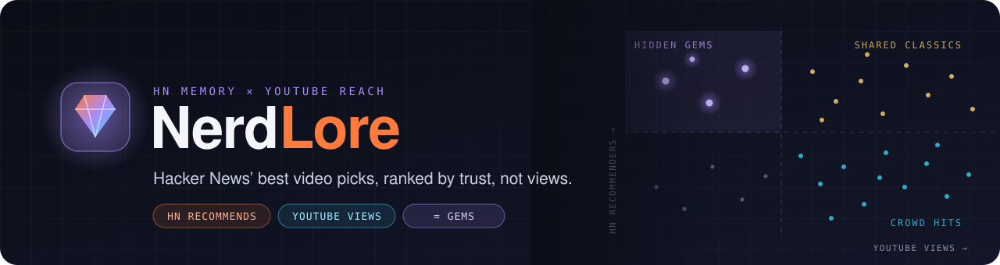
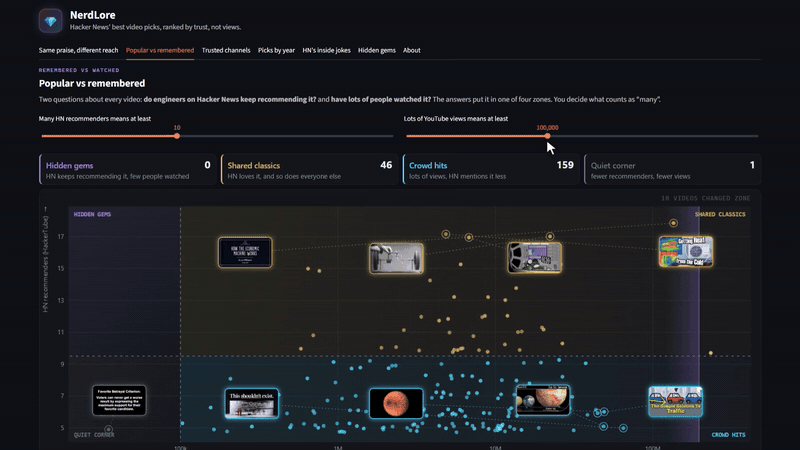
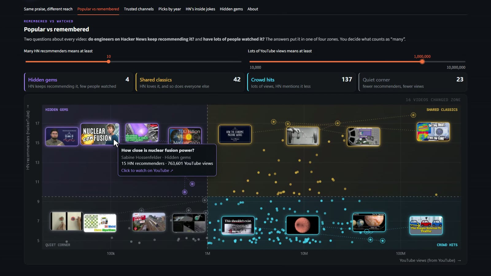
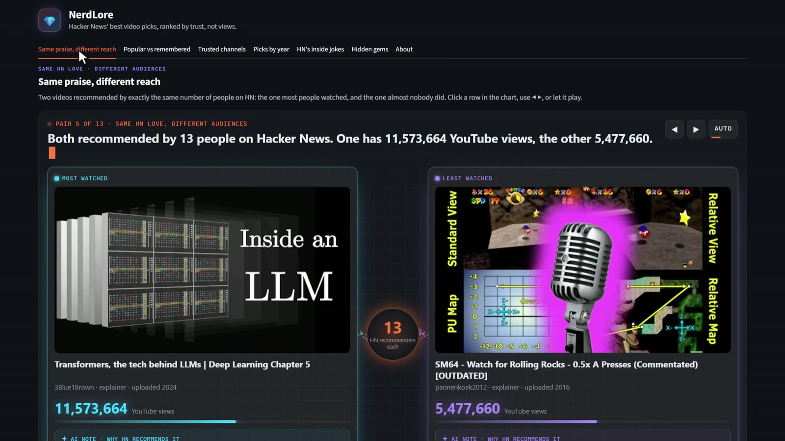
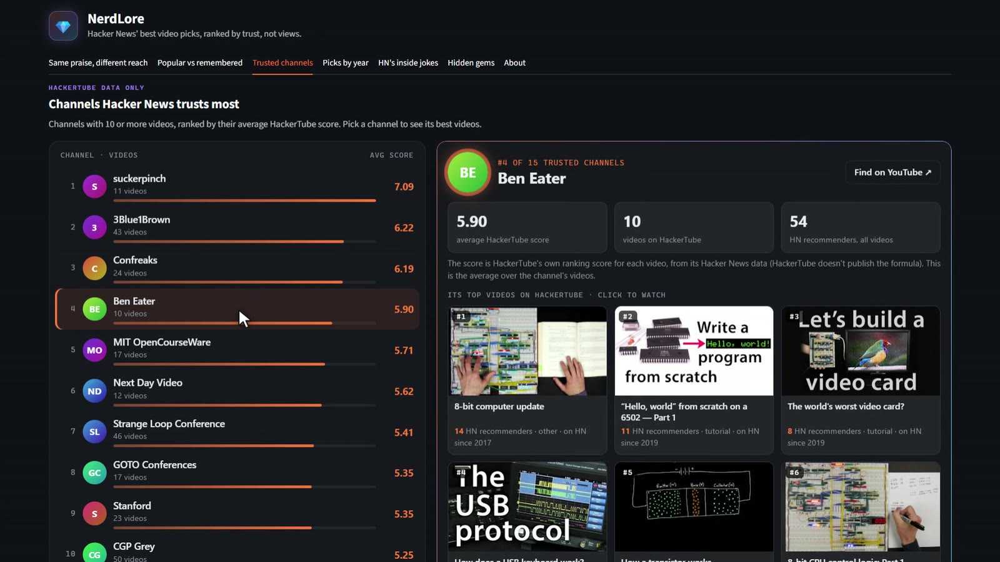
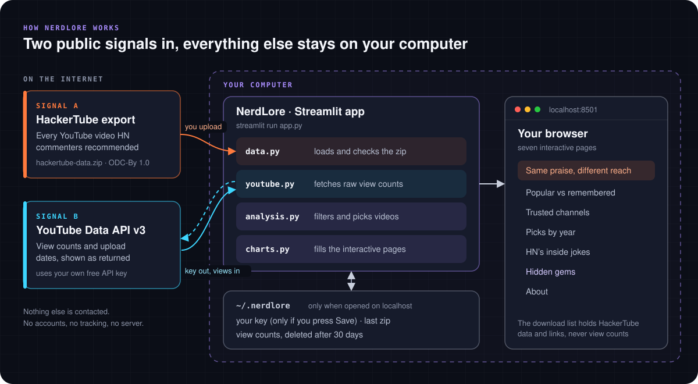

<h1 align="center">
  
</h1>

<p align="center">
  <a href="LICENSE"></a>
  <a href="https://www.python.org/downloads/"></a>
  <a href="https://streamlit.io"></a>
  <a href="https://github.com/saeedkhattak/nerdlore/actions/workflows/tests.yml"></a>
  <a href="https://opendatacommons.org/licenses/by/1-0/"></a>
  
</p>

<p align="center">
  <a href="docs/media/nerdlore-demo.mp4">
    
  </a>
  <br>
  <sub>▶ <a href="docs/media/nerdlore-demo.mp4">Watch the 45-second demo (MP4)</a></sub>
</p>

<p align="center">
  <a href="#-quick-start">Quick start</a> •
  <a href="#-before-you-start">Before you start</a> •
  <a href="#-run-it-on-your-computer">Run it step by step</a> •
  <a href="#-run-it-on-a-server">Run it on a server</a> •
  <a href="#-what-you-get">What you get</a> •
  <a href="#-how-it-works">How it works</a> •
  <a href="#-your-data-and-privacy">Your data</a> •
  <a href="#-troubleshooting">Troubleshooting</a> •
  <a href="#-contributing">Contributing</a>
</p>

---

For nearly 20 years, Hacker News commenters have been pointing each other to YouTube talks,
lectures and explainers. [HackerTube](https://hackertube.org) collected every one of those
recommendations and publishes them as open data. YouTube, meanwhile, counts views.

**NerdLore puts the two side by side.** It shows you the videos engineers keep recommending,
next to how many people actually watched them, so you can find the great talks the
algorithm never pushed: the ones that are *loved by Hacker News, missed by everyone else*.

> NerdLore is not affiliated with HackerTube, Hacker News, Y Combinator,
> YouTube or Google.

---

## ⚡ Quick start

Already have Python and a YouTube API key? Three commands:

```bash
git clone https://github.com/saeedkhattak/nerdlore.git && cd nerdlore
pip install -r requirements.txt
streamlit run app.py
```

Then upload [`hackertube-data.zip`](https://hackertube.org/data) in the sidebar, paste your key
and press **Run analysis**. New to any of this? Follow the steps below.

---

## 🧰 Before you start

You need four things. Only the last two take more than a minute.

| You need | Why | How to get it |
|---|---|---|
| **Python 3.10 or newer** | NerdLore is a Python app | [python.org/downloads](https://www.python.org/downloads/). On Windows, tick **"Add python.exe to PATH"** in the installer. Check with `python --version` |
| **Git** (optional) | To download the code | [git-scm.com](https://git-scm.com/downloads), or use GitHub's **Code → Download ZIP** button instead |
| **A free YouTube API key** | To fetch view counts | About 5 minutes with any Google account: see [Get a YouTube API key](docs/youtube-api-key.md) |
| **The HackerTube data file** | The list of videos HN recommended | Download `hackertube-data.zip` (about 18 MB) from [hackertube.org/data](https://hackertube.org/data) |

No database, no server, no sign-up with this project, and no paid services. The YouTube key
is free: the daily free quota is far more than NerdLore needs.

---

## 🚀 Run it on your computer

### 1. Get the code

```bash
git clone https://github.com/saeedkhattak/nerdlore.git
cd nerdlore
```

### 2. Install

Pick one of the three ways below. They all end with the same app.

#### Option A: in a virtual environment (recommended)

A virtual environment keeps NerdLore's packages in the project folder, so they can't clash
with anything else on your computer, and deleting the folder removes everything.

**Windows (PowerShell)**

```powershell
python -m venv .venv
.venv\Scripts\Activate.ps1
pip install -r requirements.txt
```

> If PowerShell says running scripts is disabled, run
> `Set-ExecutionPolicy -Scope CurrentUser RemoteSigned` once, or use Command Prompt and
> `.venv\Scripts\activate.bat` instead.

**macOS / Linux**

```bash
python3 -m venv .venv
source .venv/bin/activate
pip install -r requirements.txt
```

Each time you open a new terminal to run NerdLore, run the `activate` line again first.

#### Option B: directly on your computer, no virtual environment

This installs Streamlit and pandas into your main Python, for your user only. It is the
quickest way, but it can upgrade packages that other Python projects on your computer use.

**Windows**

```powershell
python -m pip install --user -r requirements.txt
```

**macOS / Linux**

```bash
python3 -m pip install --user -r requirements.txt
```

> On recent macOS (Homebrew Python) and Linux versions (for example Ubuntu 23.04 and later),
> pip refuses with *externally-managed-environment*. That is the system protecting its own
> Python: use Option A or C instead.

#### Option C: one command with uv, nothing to set up

If you have [uv](https://docs.astral.sh/uv/), it installs everything in a cache and starts the
app in one step (and you can skip step 3):

```bash
uv run --with-requirements requirements.txt streamlit run app.py
```

### 3. Start the app

```bash
streamlit run app.py
```

If you used Option B and `streamlit` is not found, use `python -m streamlit run app.py`
(`python3` on macOS/Linux) instead.

Your browser opens at **http://localhost:8501**. If it doesn't, open that address yourself.
To stop the app, press `Ctrl+C` in the terminal.

### 4. Your first run

1. **Get the data.** In the sidebar, press **Get the zip from hackertube.org** and download
   `hackertube-data.zip`.
2. **Upload it** with the sidebar's upload box. NerdLore keeps a copy, so next time you can
   skip this step.
3. **Paste your YouTube API key.** Press **Save key** if you want NerdLore to remember it on
   this computer (it is stored in your home folder, never in the project folder).
4. **Choose what to compare.** Pick video types (talks, lectures, explainers…) and the minimum
   number of HN recommenders.
5. Press **Run analysis.** View counts arrive in a few seconds, and the app opens on
   **Same praise, different reach**.

---

## 🌐 Run it on a server

NerdLore is built to run on your own computer, but you can host it so you can open it from
anywhere, or share it with friends or a team.

### What changes on a server

When the app is opened from any address other than `localhost`, it **saves nothing**:

- Each visitor pastes **their own** YouTube API key every visit. The **Save key** button is
  hidden, so no one's key is ever written to the server's disk.
- Each visitor uploads the HackerTube zip, and **Run analysis** fetches fresh view counts every
  time, using that visitor's own quota.
- Keys travel from the visitor's browser through your server to YouTube, so **always use
  HTTPS**, and only host it somewhere you trust.
- Anyone who has the address can use it. To keep it private, put a password in front of it
  (see the Caddy example below).

### Option 1: on your home or office network

Let other devices on the same Wi-Fi or network open the app:

```bash
streamlit run app.py --server.address 0.0.0.0
```

Others then open `http://<your-computer's-IP>:8501` (the terminal prints it as *Network URL*).
On Windows, allow Python through the firewall when asked. This is plain HTTP, so only do it on
a network you trust. You can keep using `http://localhost:8501` on your own computer, where
saving still works.

### Option 2: your own Linux server or VPS

**1. Install and test** (Ubuntu/Debian shown):

```bash
sudo apt install -y git python3-venv
git clone https://github.com/saeedkhattak/nerdlore.git && cd nerdlore
python3 -m venv .venv
.venv/bin/pip install -r requirements.txt
.venv/bin/streamlit run app.py --server.address 127.0.0.1 --server.port 8501 --server.headless true
```

Keep Streamlit on `127.0.0.1` so it is only reachable through the web server in front of it.

**2. Put HTTPS in front with [Caddy](https://caddyserver.com/docs/install).** Point a domain at
your server, then use this `/etc/caddy/Caddyfile`:

```caddyfile
nerdlore.example.com {
    reverse_proxy 127.0.0.1:8501
}
```

Caddy gets and renews the HTTPS certificate by itself, and passes through the WebSocket
connection Streamlit needs. (Any other reverse proxy works too, as long as it supports
WebSockets.) To add a password, run `caddy hash-password` and add this inside the block:

```caddyfile
    basic_auth {
        friend <the-hash-it-printed>
    }
```

**3. Keep it running** after you log out or reboot, with a systemd service in
`/etc/systemd/system/nerdlore.service` (change `youruser` and the paths to yours):

```ini
[Unit]
Description=NerdLore
After=network.target

[Service]
User=youruser
WorkingDirectory=/home/youruser/nerdlore
ExecStart=/home/youruser/nerdlore/.venv/bin/streamlit run app.py --server.address 127.0.0.1 --server.port 8501 --server.headless true
Restart=on-failure

[Install]
WantedBy=multi-user.target
```

```bash
sudo systemctl daemon-reload
sudo systemctl enable --now nerdlore
```

To update later: `git pull`, `.venv/bin/pip install -r requirements.txt`, then
`sudo systemctl restart nerdlore`.

### Option 3: Streamlit Community Cloud (free hosting)

1. Fork this repo on GitHub.
2. In your fork, delete the `address = "localhost"` line from
   [`.streamlit/config.toml`](.streamlit/config.toml). It is only there to keep copies on
   personal computers private, and the hosting service sets its own address.
3. Sign in at [share.streamlit.io](https://share.streamlit.io) with GitHub, choose
   **Create app**, pick your fork, branch `main` and file `app.py`, then **Deploy**.

Community Cloud apps are public by default. You can limit who can open yours in the app's
sharing settings.

### If you host it for the public

You become the operator of an app that uses YouTube API Services, so YouTube's
[developer policies](https://developers.google.com/youtube/terms/developer-policies) apply to
you. Keep the privacy notice and the small print at the bottom of every page, don't add
analytics or logging that could capture keys, and keep the 30-day rule for any YouTube data
you store.

Next time, just run `streamlit run app.py` again (with the virtual environment active). Your
last results come back without spending any quota, until they are 30 days old.

---

## ✨ What you get

Seven interactive pages, all drawn with plain HTML, CSS and canvas (no chart libraries):

| Page | What it shows | Data used |
|---|---|---|
| **Same praise, different reach** | Two videos with exactly the same number of HN recommenders: the one most people watched and the one almost nobody did, side by side with HackerTube's AI notes on why HN recommends each. Auto-plays through every pair | HackerTube + YouTube |
| **Popular vs remembered** | A live map of every video by HN recommenders and YouTube views, split into four zones (hidden gems, shared classics, crowd hits, quiet corner) by two thresholds you set. Each zone's top videos float on the map as thumbnails | HackerTube + YouTube |
| **Trusted channels** | Channels ranked by their average HackerTube score; pick one to see its stats and a filmstrip of its best videos | HackerTube only |
| **Picks by year** | A time machine: a timeline of videos per year (by upload year or first HN mention), with each year's most recommended videos | HackerTube + YouTube |
| **HN's inside jokes** | The clips HN posts as running gags, what the joke is, when it gets posted, and real HN threads | HackerTube only |
| **Hidden gems** | Videos with at least N HN recommenders and fewer than X YouTube views (you pick both), ranked by a rule spelled out on screen, with a real HN quote for each | HackerTube + YouTube |
| **About** | How the app works and the full privacy notice | |

<table>
  <tr>
    <td width="33%"></td>
    <td width="33%"></td>
    <td width="33%"></td>
  </tr>
  <tr>
    <td align="center"><sub>Popular vs remembered</sub></td>
    <td align="center"><sub>Same praise, different reach</sub></td>
    <td align="center"><sub>Trusted channels</sub></td>
  </tr>
</table>

An optional button on the Hidden gems page searches YouTube for **other uploads** of the top
gems, because a talk can look unwatched when a different copy holds the views.

---

## 🧭 How it works

<p align="center">
  
</p>

1. **Signal A, what Hacker News remembers.** HackerTube's export lists every YouTube video HN
   commenters recommended, with how many *different* people recommended it, plus labels
   (talk, lecture, joke, news…) written by an LLM. You download it and upload it to the app.
2. **Signal B, what the crowd watched.** With your own key, the app asks the YouTube Data API
   for each video's view count and upload date, 50 videos per request.
3. **Put together on your computer.** The app filters and pairs videos, then fills the
   interactive pages. View counts are shown **exactly as YouTube returns them**: NerdLore
   sorts and filters by them, but never turns them into averages, ratios or scores.

Nothing else is contacted. There are no accounts, no analytics and no NerdLore server.

---

## 🔒 Your data and privacy

| What | Where it lives | How long |
|---|---|---|
| Your YouTube API key | In memory; on disk in `~/.nerdlore` **only if you press Save key** | Until you press **Forget key** |
| The HackerTube zip you uploaded | `~/.nerdlore` | Until you upload a new one |
| YouTube view counts and upload dates | `~/.nerdlore` | **Deleted after 30 days**, or right away with **Forget YouTube data** |

- `~/.nerdlore` is a folder in your home folder (`C:\Users\<you>\.nerdlore` on Windows), not in
  the project, so none of it can be committed to git by accident.
- Nothing is saved at all when the app is opened from an address other than `localhost`.
- Your key is sent only to Google's YouTube Data API over HTTPS. It is never logged or put in
  an error message, and the tests check that.
- The **Download list** button exports HackerTube data and YouTube links only, never view counts.
- Streamlit's own usage statistics are switched off in [`.streamlit/config.toml`](.streamlit/config.toml).

Full details: [PRIVACY.md](PRIVACY.md).

### What is in this repo, and what isn't

| In the repo | Not in the repo, on purpose |
|---|---|
| The app's code, tests, docs and demo media | **Any API key.** Each person uses their own |
| Small made-up data used by the tests | **YouTube view counts.** YouTube's API policies only allow keeping them for 30 days, and only for the person who fetched them |
| | **HackerTube's data.** It is open data (ODC-By 1.0), but it is updated regularly and is about 18 MB, so everyone downloads the current copy from [hackertube.org/data](https://hackertube.org/data) |

---

## 📊 YouTube quota

The free YouTube Data API quota is **10,000 units per day** per Google project.

| Action | Cost |
|---|---|
| **Run analysis** | 1 unit per 50 videos, so even 1,000 videos cost only 20 units |
| Refreshing the page or reopening the app | 0 units: results come from `~/.nerdlore` |
| **Search for other uploads** (Hidden gems page, optional) | About 100 units per video checked |

---

## 🩺 Troubleshooting

| You see | What to do |
|---|---|
| `python` is not recognized / command not found | On Windows, reinstall Python with **Add python.exe to PATH** ticked, or use `py` instead of `python`. On macOS/Linux use `python3` |
| `streamlit` is not recognized | The virtual environment isn't active: run the activate command from step 2 again. Or use `python -m streamlit run app.py` |
| *error: externally-managed-environment* | Your system Python doesn't allow installing packages into it. Use Option A (virtual environment) or Option C (uv) from step 2 |
| *Port 8501 is already in use* | Another copy is running. Stop it, or run `streamlit run app.py --server.port 8502` |
| *YouTube rejected the API key* | Copy the whole key again from the Google Cloud console, with no spaces |
| *YouTube refused the request* | Enable **YouTube Data API v3** for the key's project, and if you restricted the key, allow that API ([guide](docs/youtube-api-key.md)) |
| *Your API key has used up today's YouTube quota* | Wait until the quota resets (midnight Pacific time), or skip **Search for other uploads**, which is the expensive part |
| *The zip has no videos.jsonl* / *That file is not a zip* | Upload the unmodified `hackertube-data.zip` from [hackertube.org/data](https://hackertube.org/data) |
| *No videos match those filters* | Choose more video types or lower the minimum number of HN recommenders |
| My key or results are gone after a refresh | Press **Save key** to keep the key. Saved results only come back when the app runs on `localhost` |

Still stuck? [Open an issue](https://github.com/saeedkhattak/nerdlore/issues) with what you did
and the message you saw. **Never paste your API key into an issue.**

---

## 🗂 Project layout

```
app.py                   Streamlit app: sidebar, tabs, layout
nerdlore/data.py         loads and checks the HackerTube export
nerdlore/youtube.py      YouTube Data API calls (your key, raw view counts)
nerdlore/analysis.py     filters and selections (no metrics made from YouTube data)
nerdlore/charts.py       fills the interactive pages with data
nerdlore/*.html          the interactive pages (plain HTML, CSS and canvas; no libraries)
nerdlore/local_store.py  saves your key, the zip and view counts in ~/.nerdlore
tests/                   tests with small made-up data; no network, no key needed
docs/                    API key guide, images and the demo clip
PRIVACY.md               privacy notice shown in the app
```

## 🧪 Development

```bash
pip install -r requirements.txt pytest
pytest
```

The tests run with made-up data and a fake YouTube API, so they need no key and no internet.
GitHub Actions runs them on Python 3.10 and 3.13 for every push and pull request.

## 🤝 Contributing

Ideas, bug reports and pull requests are welcome. See [CONTRIBUTING.md](CONTRIBUTING.md) for
how to set up, the rules about YouTube data, and what makes a good pull request.

---

## 📜 Rules NerdLore follows

**YouTube API Services Developer Policies**

- View counts are shown exactly as YouTube returns them. Nothing is calculated from them (no
  averages, medians, totals, ratios or scores; policies III.E.4.h and III.E.2.b). They are only
  sorted and filtered.
- Data that isn't from YouTube (HN recommenders, ranks, labels) is labelled as such.
- YouTube data is kept for at most 30 days (III.E.4), then deleted automatically.
- Each user brings their own API key; none is included in this code (III.D.1).
- Every page's small print says that using the app means agreeing to the
  [YouTube Terms of Service](https://www.youtube.com/t/terms), links the
  [Google Privacy Policy](https://policies.google.com/privacy), opens the privacy notice in one
  click (III.A), and credits YouTube as the source of view counts.

**HackerTube data: ODC-By 1.0**

The video list, recommender counts, scores and labels come from
[HackerTube](https://hackertube.org)'s export, derived from the
[open-index/hacker-news](https://huggingface.co/datasets/open-index/hacker-news) dataset
(Hacker News data by Y Combinator), and licensed under
[ODC-By 1.0](https://opendatacommons.org/licenses/by/1-0/). HN comments remain the work of
their authors. HackerTube's labels were written by an LLM, so expect a few percent of noise.

## 📄 License

The code is MIT-licensed: see [LICENSE](LICENSE). The license covers this code only, not
HackerTube's data, Hacker News comments, YouTube data or the videos and thumbnails shown in
the app and demo, which belong to their creators.

---

<p align="center">
  <sub>Built with <a href="https://streamlit.io">Streamlit</a> ·
  Data from <a href="https://hackertube.org">HackerTube</a> ·
  View counts from the <a href="https://developers.google.com/youtube/v3">YouTube Data API</a></sub>
</p>
